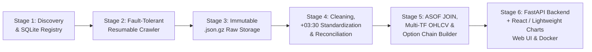

# TSETMC Options Market Tick-Data Platform (Phase 1)

A fully Dockerized, end-to-end **Tehran Stock Exchange (TSETMC) Options Market Tick-Data Platform** covering all **25 canonical underlying assets** and their **active and expired Call (`ض...`) and Put (`ط...`) option contracts** from **1402/01/01 SH (`20230321`)** to the present.

---

## 1. Six-Stage Pipeline Architecture



### Stage-by-Stage Overview
1. **Stage 1 (`src/stage1_discovery.py`) — Discovery & Instrument Registry**:
   - Registers all **25 canonical underlying assets** (`فولاد`, `فملی`, `اهرم`, `خودرو`, `شستا`, `خساپا`, `وبملت`, `وتجارت`, `وبصادر`, `شپنا`, `شبندر`, `کگل`, `کچاد`, `پالایش`, `دارا یکم`, `شتاب`, `سرو`, `موج`, `آتیمس`, `توان`, `جهش`, `عیار`, `کهربا`, `ذوب`, `غدیر`).
   - Combines active `/Instrument/GetInstrumentOptionMarketWatch/0` with systematic `/Instrument/GetInstrumentSearch/{ض|ط}{root}` prefix queries to capture **both active AND expired option contracts** since `20230321` (1402 SH).
   - Enriches metadata via `/Instrument/GetInstrumentInfo/{insCode}` and parses `lVal30` (`اختيارخ فولاد-4500-20261221`) for strike price, expiration date (`YYYYMMDD`), contract size, Call/Put type, underlying `ua_ins_code`, and `is_expired`.
   - Probes `https://cdn.tsetmc.com/api` with a 10s timeout and automatically falls back to deterministic fixtures (`data/fixtures/`) when running offline or from non-Iranian cloud IPs.

2. **Stage 2 & 3 (`src/stage2_3_crawler_storage.py`) — Fault-Tolerant Resumable Crawler & Immutable Raw Storage**:
   - Crawls `/ClosingPrice/GetClosingPriceDailyList/{insCode}/0` first and only fetches `/Trade/GetTradeHistory/{insCode}/{YYYYMMDD}/false` for days where `dEven >= 20230321` **AND** `zTotTran > 0`.
   - Enforces rate limiting (`TSETMC_MAX_RPS=2.0`), exponential backoff retry on HTTP `429`/`5xx`/timeouts, an immediate circuit breaker (`CrawlerBannedError`) on HTTP `403`, and a Tehran market trading-hours guard (`Sat–Wed 09:00–12:30 UTC+03:30`).
   - Atomically writes unmodified gzipped responses to `data/raw/daily/{insCode}.json.gz` and `data/raw/ticks/{insCode}/{YYYYMMDD}.json.gz`, tracking checkpoints in SQLite `raw_manifest`.

3. **Stage 4 (`src/stage4_cleaning.py`) — Cleaning, `+03:30` Timestamp Standardization & Quality Reconciliation**:
   - **Injects `insCode` and `dEven`**: Fixes TSETMC's API quirk where every raw `tradeHistory` item returns `"insCode": null` and `"dEven": 0`.
   - **Fixed `UTC+03:30` No-DST Rule**: Iran permanently abolished Daylight Saving Time in March 2023 (1402 SH). All timestamps from 1402 onwards use a fixed `+03:30` offset (`2023-05-24T09:00:05+03:30` -> `2023-05-24T05:30:05Z`), preventing legacy OS `tzdata` from applying summer `+04:30` offsets.
   - **Deterministic Intra-Second Sorting**: Sorts ticks by `(dEven ASC, hEven ASC, nTran ASC)` to preserve exact chronological order when multiple trades execute in the same second.
   - **Canceled Trade Separation & Reconciliation**: Filters `canceled != 0` into `canceled_ticks` and reconciles valid trade counts (`count`) and volumes (`sum(qTitTran)`) against `closingPriceDaily.zTotTran` and `qTotTran5J`, verifying the **≥ 98% match rate acceptance target**.

4. **Stage 5 (`src/stage5_series.py`) — Unified Sequences (`ASOF JOIN`), OHLCV Candles & Option Chains**:
   - **Clean Tick Stream with Underlying Price (`ASOF JOIN`)**: Matches every valid option trade with the latest valid trade of its underlying asset at or immediately prior (`ts_underlying <= ts_option`) using `bisect_right`, computing dynamic `ITM`/`ATM`/`OTM` moneyness.
   - **Multi-Timeframe OHLCV Candles (`1m`, `5m`, `15m`, `1h`, `1d`)**: Generates continuous intraday grids, handling illiquid/sparse intervals by tracking `close_ffill`, `volume = 0`, `trade_count = 0`, and `is_sparse = 1`.
   - **Option Chain Builder**: Pairs Call and Put contracts around Strike prices and Expiration dates (`DTE`).

5. **Stage 6 (`src/api.py`, `frontend/`) — FastAPI Backend, React + Lightweight Charts UI & Docker**:
   - REST API serving `/api/health`, `/api/underlyings`, `/api/options`, `/api/option-chain`, `/api/ticks`, `/api/candles`, and `/api/quality-report`.
   - React + TypeScript + Tailwind CSS + TradingView `lightweight-charts` dashboard displaying synchronized Underlying & Option candlestick charts (`close_ffill` overlay + volume histogram), interactive Option Chain table, `ASOF JOIN` tick stream, and Data Quality dashboard.

---

## 2. Database & Storage Schema

| Table / Path | Stage | Description |
| :--- | :---: | :--- |
| `instruments` | Stage 1 | Instrument registry (`ins_code`, `symbol`, `full_name`, `instrument_type`, `ua_ins_code`, `strike_price`, `end_date`, `contract_size`, `is_expired`) |
| `raw_manifest` | Stage 2–3 | Checkpoint manifest (`artifact_key`, `ins_code`, `d_even`, `file_path`, `http_status`, `compressed_bytes`, `raw_record_count`, `downloaded_at`) |
| `data/raw/daily/{insCode}.json.gz` | Stage 3 | Immutable raw daily closing price JSON archive |
| `data/raw/ticks/{insCode}/{YYYYMMDD}.json.gz` | Stage 3 | Immutable raw intraday tick JSON archive |
| `clean_daily` | Stage 4 | Cleaned daily history with `+03:30` / UTC timestamps |
| `clean_ticks` | Stage 4 | Deterministically sorted tick trades with injected `ins_code` & `d_even` |
| `canceled_ticks` | Stage 4 | Audit log of canceled trades (`canceled != 0`) |
| `reconciliation_report` | Stage 4 | Per-day reconciliation (`MATCH`, `MISMATCH`, `MISSING_TICKS`) against `zTotTran` & `qTotTran5J` |
| `option_ticks_matched` | Stage 5 | Option tick stream joined (`ASOF JOIN`) with simultaneous underlying asset price & moneyness |
| `ohlcv_candles` | Stage 5 | Resampled `1m`, `5m`, `15m`, `1h`, `1d` candles with `close_ffill` and `is_sparse` flag |

---

## 3. Quickstart & CLI Usage

### Run with Docker Compose (Out-of-the-Box with Seed Dataset)
```bash
docker compose up --build
```
- **Backend API & Embedded Dashboard**: `http://localhost:8000` (Swagger docs at `http://localhost:8000/docs`)
- **Frontend UI (React + Lightweight Charts)**: `http://localhost:5173`

### Local Development & CLI Commands
```bash
# Seed database, raw .json.gz files, and processed .jsonl series from deterministic fixtures
python3 -m src.seed

# Run individual pipeline stages via CLI
python3 -m src.cli stage1 --use-fixtures
python3 -m src.cli stage2-3 --use-fixtures
python3 -m src.cli stage4
python3 -m src.cli stage5
python3 -m src.cli report

# Start FastAPI server locally
uvicorn src.api:app --host 0.0.0.0 --port 8000

# Run the automated pytest suite
python3 -m pytest -v
```

---

## 4. AI Engineering Workflow
- **`flash-delegation` Two-Tier Model Routing**:
  - Routed well-scoped data modeling, fixture generation, resumable crawler storage, FastAPI endpoints, React UI components, and unit tests to `flash` subagents, while keeping architecture verification and Stage 4/5 algorithmic invariants (`+03:30` No-DST math, intra-second sorting, `bisect_right` `ASOF JOIN`, sparse candle forward-filling) tightly specified.
- **`ponytail` Minimal-Diff Discipline**:
  - Zero-bloat standard library + Pydantic v1 + SQLite + FastAPI implementation that runs cleanly both online against `https://cdn.tsetmc.com/api` and offline in air-gapped/cloud containers.
